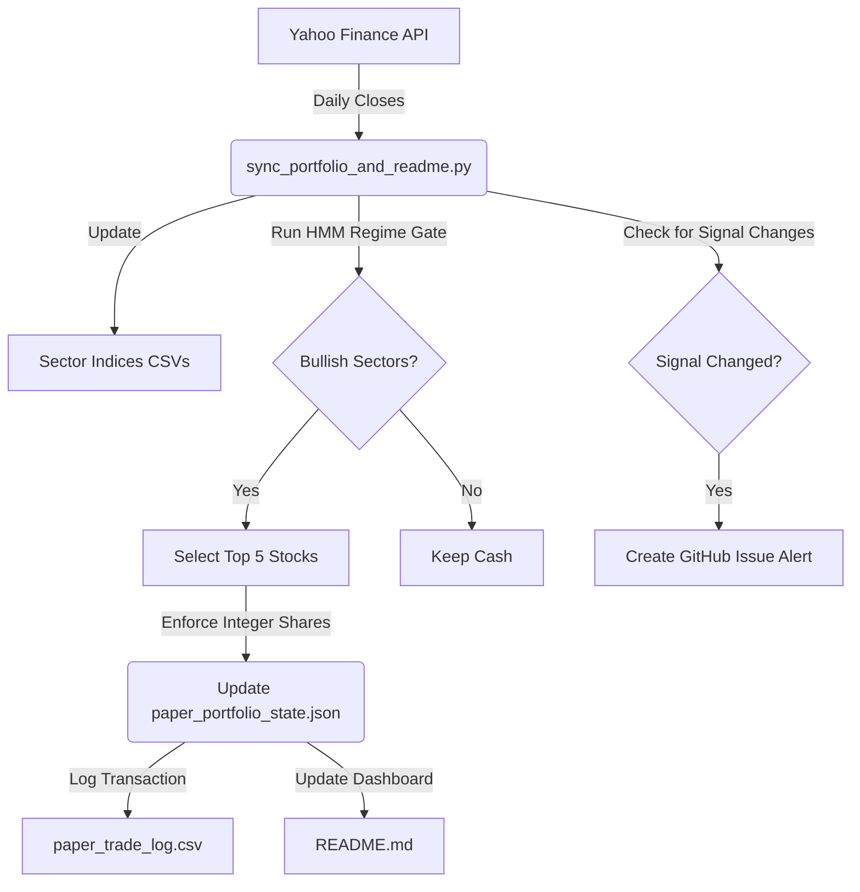

# Technical Report: HMM Sector-Switching & Trading System

This report provides a comprehensive, in-depth overview of the **Gaussian Hidden Markov Model (HMM) Sector-Switching Strategy** developed for the COEP Quantitative Finance Club. It covers the strategy's mathematical foundation, backtest results, local execution engines, automated cloud sync pipelines, and the roadmap for broker integration.

---

## 1. Executive Summary & Core Strategy

Standalone sector-switching strategies historically suffer from **cash drag**: when a sector is classified as bearish, the capital exits that sector and sits in cash earning 0% return.

This platform solves cash drag by implementing a **dynamic, equal-weighted multi-sector portfolio**. Instead of leaving exited capital in cash, it dynamically reallocates it to active, bullish sectors on a monthly or signal-change basis.

### The Algorithm:
1. **Sector Indices Construction**: We track **32 custom sector indices** constructed as equal-weighted averages of their constituent stocks' closing prices.
2. **Feature Extraction**: For each sector index, we calculate:
   - Annualized 10-day rolling return volatility.
   - Log returns (causal smoothing window $k=2$ to filter out whipsaws).
3. **Regime Decoding (Gaussian HMM)**: 
   - A Gaussian HMM fits three states: Bullish (State 0, highest mean returns), Neutral (State 1), and Bearish (State 2).
   - Only sectors classified in **State 0 (Bullish)** at the end of the month are eligible for investment.
4. **Stock Selection & Ranking**: 
   - Inside active bullish sectors, stocks are scored based on a combination of hedge fund institutional holdings (Z-score) and qualitative analyst ratings (Z-score).
   - The top 5 stocks across all active sectors are selected for the portfolio.
5. **Execution Constraint**: Enforces **integer-only share counts** (no fractional shares) to match real-world trading constraints, storing leftover funds in the cash balance.

---

## 2. Historical Performance & Backtest Results

We verified the strategy across two simulation windows using EOD prices:

### A. Full Period Backtest (Jan 2015 – Aug 2026)
* **Starting Capital**: ₹100,000.00
* **Ending Capital**: **₹1,763,930.85**
* **Total Return**: **+1,663.93%**
* **CAGR**: **28.82%** (vs. ~13.41% average buy-and-hold sector benchmark)
* **Sharpe Ratio**: **1.2097**
* **Max Drawdown**: **-40.89%** (primarily during the March 2020 COVID crash)

### B. Recent 1-Year Backtest (Aug 6, 2025 – Aug 6, 2026)
* **Starting Capital**: ₹100,000.00
* **Ending Capital**: **₹123,414.03**
* **Total Return**: **+23.41%**
* **Sharpe Ratio**: **1.1585**
* **Max Drawdown**: **-15.51%**

---

## 3. Platform Architecture & Local Environment

The codebase is organized into modular scripts:



### Key Files in Workspace:
* **[`live_paper_trading.py`](file:///c:/Users/Ved%20Bajaj/Desktop/Lifox/QF%20Club/HHM/live_paper_trading.py)**: Interactive command-line terminal. Allows you to check the portfolio holdings, reset state, review transaction logs, and run walk-forward predictions.
* **[`scratch/paper_portfolio_state.json`](file:///c:/Users/Ved%20Bajaj/Desktop/Lifox/QF%20Club/HHM/scratch/paper_portfolio_state.json)**: The JSON database representing your live paper trading account. It stores cash balance, holdings (shares, average cost price, current close), and historical NAV.
* **[`scratch/paper_trade_log.csv`](file:///c:/Users/Ved%20Bajaj/Desktop/Lifox/QF%20Club/HHM/scratch/paper_trade_log.csv)**: Complete audit trail of all buy, sell, and rebalance trades.
* **[`scratch/sync_portfolio_and_readme.py`](file:///c:/Users/Ved%20Bajaj/Desktop/Lifox/QF%20Club/HHM/scratch/sync_portfolio_and_readme.py)**: The central synchronization engine. Runs the daily data fetch, rebalancing logic, and updates your repository dashboard.

---

## 4. Automated Daily Workflows & Alerts

To keep the system fully hands-free, we established two automated runner systems:

### A. GitHub Actions Workflow (`daily_sync.yml`)
Runs in the cloud on GitHub's servers every **Monday–Friday at 5:00 PM IST** (11:30 AM UTC):
1. **Checks out** your repository.
2. **Installs python dependencies** using a cached pip environment (`requirements.txt`).
3. Runs `sync_portfolio_and_readme.py` to value your portfolio.
4. **Signal Change Alert**: If the target stocks today differ from yesterday, it calls GitHub's CLI tool to **automatically create a new GitHub Issue** titled `ACTION REQUIRED: HMM Portfolio Rebalance - [DATE]`. This triggers a push notification/email to your phone, telling you exactly which stocks to buy and sell!
5. **Dashboard Update**: Automatically commits and pushes the updated price CSVs, portfolio state JSON, trade log, and the `README.md` dashboard back to your repository.

### B. Local Scheduler
A local batch runner [`run_daily_local.bat`](file:///c:/Users/Ved%20Bajaj/Desktop/Lifox/QF%20Club/HHM/run_daily_local.bat) is registered in the IDE scheduler to run on your local machine at **4:30 PM IST** on weekdays.

---

## 5. Live Repository Dashboard (`README.md`)

The home page of your private GitHub repository `https://github.com/Ved-2107/Sectors.git` has been turned into a **live quant dashboard**. 
Every EOD, it automatically updates to show:
1. **Portfolio NAV** and total Return on Investment (ROI).
2. **Holdings Table**: Symbols, Sectors, Share counts (integers), average buy cost, current closing price, current market value, and profit/loss.
3. **Transaction History**: Audit logs of your latest 10 executed trades.

---

## 6. What We Are Going to Do: Next Steps & Roadmap

To move this from a paper trading dashboard to an institutional live trading terminal, we recommend the following three phases:

### Phase 1: Broker API Integration (Automation)
Currently, the sync script logs paper trades to `paper_portfolio_state.json`. To execute real orders, we can integrate a broker API wrapper (e.g., Zerodha Kite Connect, Dhan API, or Upstox):
* **Order Placement**:
  We can replace the local paper logging step in `sync_portfolio_and_readme.py` with API calls:
  ```python
  # Example Zerodha order execution:
  kite.place_order(
      variety=kite.VARIETY_REGULAR,
      exchange=kite.EXCHANGE_NSE,
      tradingsymbol="GESHIP",
      transaction_type=kite.TRANSACTION_TYPE_BUY,
      quantity=15,
      product=kite.PRODUCT_CNC,
      order_type=kite.ORDER_TYPE_MARKET
  )
  ```

### Phase 2: Refined Risk Management
To protect your ₹1.5 lakh capital during high-volatility events, we can implement:
* **Trailing Stop-Loss**: Add a trailing stop-loss (e.g., -8% from the highest close) in the daily script. If a stock hits the stop, the script sells it immediately and updates your state.
* **Maximum Drawdown Cap**: If the total portfolio NAV drops by more than 15% in a single month, the strategy automatically liquidates all holdings into cash and pauses trading for the next 30 days.

### Phase 3: Multi-Regime Classification (HSMM)
In your workspace, there is a draft comparing HMM and HSMM (Hidden Semi-Markov Model). 
* HSMM models explicit state durations, preventing whipsaws and premature entry signals.
* We can transition the pipeline's regime gate from a standard HMM (`hmmlearn`) to a duration-explicit HSMM using the custom Viterbi engine in `regime_engine.py`.
